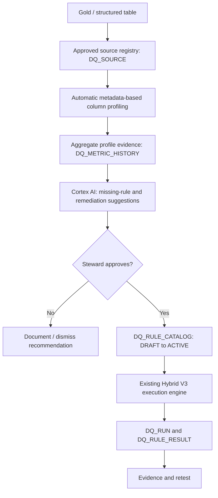

# Verity 1.0 — Structured Data Quality, Profiling & AI Recommendations

**Delivery target:** 20 November 2026  
**Current phase:** Architecture, repository baseline and deployment preparation  
**Pilot:** One Snowflake project, `VERITY_V2.PRACTICE`  
**Scope:** Structured relational tables only; Snowflake-native control plane; no Streamlit delivery

## Why build Verity?

A successful Gold model build and its existing tests do not establish that **unconfigured** quality problems are absent. Verity 1.0 adds a systematic discovery loop: it profiles structured columns even without a corresponding validation rule, presents evidence of suspicious patterns, asks Cortex AI for **reviewable** recommendations, and enforces only approved rules. It centralizes quality evidence without copying source tables.

**First use case:** an email value contains a leading space; `NOT_NULL` passes; automatic profiling finds the problem; AI suggests reviewing `TRIM(EMAIL)` and adding `NO_EDGE_WHITESPACE`; a steward activates the rule; Verity reports violations; data is corrected in the owning pipeline.

## Where we start

We will develop against the existing `VERITY_V2` Snowflake database rather than replacing or renaming it. `VERITY_V2` is the **current database/object namespace**; **Verity 1.0 is the product/release name**. No shared catalogs, runs or baseline tables are dropped or truncated during setup. The initial source is `VERITY_V2.PRACTICE.DEMO_CUSTOMER_DQ` (`SOURCE_ID=601` previously verified; re-check in the active account).

## User journey



## Current vs proposed (do not confuse)

| Component | State |
|---|---|
| Source registration: `ENGINE.SP_DQ_ONBOARD_TABLE` | Existing POC |
| Central rules: `CONFIG.DQ_RULE_CATALOG`, DRAFT/ACTIVE | Existing POC |
| Rule execution: `ENGINE.SP_DQ_EXECUTE_HYBRID_V3(VARCHAR)` | Existing and tested; `EXECUTE AS CALLER` in inspected source |
| `RANGE`, `VALUE_SET`, `CONDITIONAL_REQUIRED` | Existing and tested in source 701 |
| `MONITORING.DQ_METRIC_HISTORY` | Existing; basic numerical metrics |
| Seven-context-view Cortex Agent | Exists and was tested in Playground; **profile-driven responses not proven** |
| Generic `ENGINE.SP_DQ_PROFILE_TABLE` | **TO BUILD** |
| `NO_EDGE_WHITESPACE` execution handler | **TO BUILD** |
| Profile-evidence-to-AI recommendation workflow | **TO BUILD** |
| Multi-project onboarding | **DEFERRED** (architecture remains extensible) |
| JSON/VARIANT, Streamlit, incident automation | **OUT OF Verity 1.0 delivery scope** |

## Repository guide

| Path | Purpose |
|---|---|
| [`docs/01_PRODUCT_AND_HLD.md`](docs/01_PRODUCT_AND_HLD.md) | Objectives, scope, high-level design, differentiation |
| [`docs/02_EXECUTION_FLOW.md`](docs/02_EXECUTION_FLOW.md) | Detailed table onboarding → profiling → recommendation → execution |
| [`docs/03_DEPLOYMENT_RUNBOOK.md`](docs/03_DEPLOYMENT_RUNBOOK.md) | Ordered DEV deployment, smoke tests, rollback |
| [`docs/04_SECURITY_AND_ACCESS.md`](docs/04_SECURITY_AND_ACCESS.md) | Single-project read-only source access and procedure grants |
| [`docs/05_ROADMAP_AND_NEXT_AGENDA.md`](docs/05_ROADMAP_AND_NEXT_AGENDA.md) | November 16–20 development plan and meeting agenda |
| [`docs/06_ACCEPTANCE_TESTS.md`](docs/06_ACCEPTANCE_TESTS.md) | 12 intelligent profiling scenarios (TC_01–TC_12), positive/negative/boundary/RBAC tests and evidence gates |
| [`docs/07_ENGINEERING_DECISIONS.md`](docs/07_ENGINEERING_DECISIONS.md) | Decisions, open items and deferred features |
| [`docs/08_RELEASE_CHECKLIST.md`](docs/08_RELEASE_CHECKLIST.md) | Evidence-based readiness gate |
| `sql/00_preflight/` | **Read-only** Snowflake inventory and baseline checks |
| `sql/01_foundation/` | Existing-object exports / migrations to be added after GET_DDL |
| `sql/02_profiling/` | Future structured profiler SQL/procedure |
| `sql/03_rule_engine/` | Future whitespace rule extension; preserve V3 behavior |
| `sql/04_ai/` | Future profile context view and Agent updates |
| `sql/05_smoke_tests/` | SQL for profile evidence on an isolated test table |
| `deploy/` | Role template, environment and manual deployment policy |
| `tests/` | Test plans, fixtures and evidence |
| `.github/workflows/` | **Repository static checks only**; NO automatic Snowflake deploy |

## First setup (GitHub)

1. Create a **private** GitHub repository called `verity-1.0` (or organization-approved name); leave it empty if importing this folder.
2. Download and extract this project folder locally.
3. Run:

   ```bash
   cd verity-1.0
   git init
   git add .
   git commit -m "docs: establish Verity 1.0 architecture and deployment baseline"
   git branch -M main
   git remote add origin https://github.com/<ORG>/verity-1.0.git
   git push -u origin main
   ```

4. Protect `main`; use PRs and approvals; store **no** passwords, key material, live PII or production data in Git.
5. Review [`docs/03_DEPLOYMENT_RUNBOOK.md`](docs/03_DEPLOYMENT_RUNBOOK.md) before executing any SQL.

**This ZIP is a Git-ready local scaffold. It has not created a remote GitHub repository or deployed anything into Snowflake.**

**Expanded test coverage:** the design now specifies 12 planned discovery scenarios (7 Core, 5 Stretch). These are acceptance tests, not claims of deployed profiling capability. See `docs/06_ACCEPTANCE_TESTS.md`.
