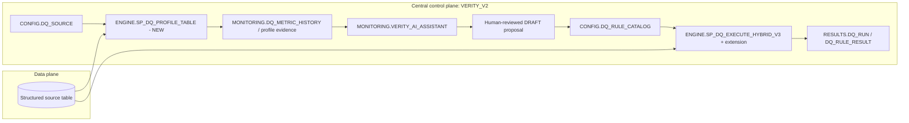

# 01 — Verity 1.0 Product Brief & High-Level Design

**Version:** 1.0 / planning baseline  
**Target:** 20 November 2026  
**Pilot:** one Snowflake project; structured tables only

## Problem statement

Existing build-time tests prove that **configured** tests passed at a point in time. They cannot guarantee the absence of unexpected formatting issues, suspicious numeric values, or other unconfigured problems. Isolated project rules also complicate governance and evidence collection.

## Vision and differentiator

Verity is an **intelligent discovery + governance + validation framework**. It finds potentially important column-level patterns **before** a person has anticipated a rule; uses Cortex AI to explain aggregate evidence and suggest remediation; then enforces only **approved** controls. Generic NOT_NULL and UNIQUE checks alone are **not** the reason for the framework.

## Business outcomes

- Automatically discover leading/trailing ordinary spaces and blank-looking strings in structured text data.
- Quantify null rates, distinct counts, numeric min/max, and basic timestamp ranges per column.
- Identify uncovered columns and suggest rules without duplicating ACTIVE/DRAFT rules.
- Preserve accountable human approval for business semantics such as valid age ranges, allowed values, required fields and normalization policy.
- Keep source data under project ownership; only aggregated profiling evidence and validation results enter the Verity control plane.
- Make findings reproducible, auditable and attributable to a source, column, observation time, validation rule and run.

## Scope

### In scope

- Existing onboarding: `SP_DQ_ONBOARD_TABLE` and central source registry.
- Structured data types: TEXT/VARCHAR; NUMBER/FLOAT; DATE/TIME/TIMESTAMP; candidate identifiers.
- Built-in auto-profiling: row counts, nulls, blanks, ordinary leading/trailing spaces, distinct counts, min/max for supported types and type-aware findings.
- Configured execution of `NOT_NULL`, `UNIQUE`, `RANGE`, `VALUE_SET`, `CONDITIONAL_REQUIRED`, plus the **new** `NO_EDGE_WHITESPACE` rule.
- Existing Cortex Agent extended to interpret **aggregate** profile evidence; DRAFT recommendation / approval workflow.
- One project, existing Snowflake account and `VERITY_V2.PRACTICE` pilot schema.

### Out of scope for November 20

- JSON/VARIANT and relational/JSON schema drift enhancements (existing V2 code stays untouched).
- Multi-project deployment, cross-account federation, source-data repair, AI auto-activation, ticketing, Streamlit, generic arbitrary-SQL checks, automatic table publication gates.

## Core conceptual architecture

## Contract and control separation

| Layer | Reads | Writes | Must not do |
|---|---|---|---|
| Onboarding | table metadata | `DQ_SOURCE`, supported DRAFT discovery | Grant itself access outside approved scope |
| Profiler (new) | authorized structured columns | aggregate profile evidence | Change source data or interpret a value as invalid without policy |
| Cortex AI | approved aggregate metrics, rule coverage | suggested text / future controlled proposal state | Execute arbitrary UPDATE or approve rules by itself |
| Steward | evidence + catalog | approved rule metadata | Write to source table as part of rule approval |
| Hybrid engine | ACTIVE rules + source records | DQ run/results | Infer that a missing rule has already been enforced |

## Evidence-based email scenario

1. Existing `EMAIL NOT_NULL` returns PASS for `' priya@example.com'`.
2. Automatic text profiling detects `EMAIL <> TRIM(EMAIL)` on one row.
3. Metric records observed count and denominator; it labels this as **ordinary edge-space incidence**, not proof of invalid email delivery.
4. AI explains potential join/contact issues and recommends a steward review of `TRIM(EMAIL)` plus `NO_EDGE_WHITESPACE`.
5. New rule is DRAFT; after approval it becomes ACTIVE; Hybrid V3 extension flags whitespace.
6. Correct the source through the owning process, rerun and verify PASS. Verity never silently repairs Gold.

## Expanded profiling scenarios in the release design

The release test design now covers **12 intelligent-discovery scenarios**, not only edge whitespace. The **core** cases are text edge spaces, blank-but-not-NULL text, normalized duplicates, negative numeric values, numeric min/max signals, NULL rates, and duplicate candidate identifiers. **Stretch** scenarios include case inconsistency, rare categorical values, heuristic email-format patterns, future timestamps and historical distribution drift. All require approved semantics before enforcement; observed profiling anomalies alone are not rule failures. See [`06_ACCEPTANCE_TESTS.md`](06_ACCEPTANCE_TESTS.md) for the complete `TC_01`–`TC_12` catalog, reference semantics and evidence gates.

## Success metrics (measurable acceptance, no ungrounded claims)

- Findings: matches reference SQL for each supported profile metric on 5-row and edge-case fixtures.
- Reproducibility: records the source, column, observed count, timestamp, and query ID for relevant metrics.
- Coverage: new text column is profiled without insertion of any rule catalog entry.
- Governance: DRAFT rules do not execute; ACTIVE rule executes.
- Isolation: read-only access to source data; no COPY/UPDATE/DELETE on source.
- AI: recommendation quotes observed evidence, identifies its uncertainty, and excludes duplicates.
- Safety: invalid configuration, missing permissions and unsupported identifiers return explicit error outcomes.

## Not a claim of uniqueness

Other quality platforms already have profiling, anomaly detection, tests or AI features. Verity's value must be evaluated through *fit to Snowflake operations, central rule governance, explainability, ownership, ease of integration, cost and observed detection accuracy*—not by assuming these capabilities are unique.
