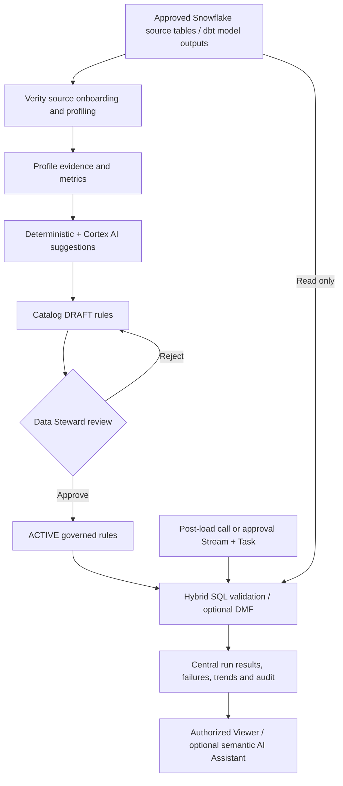

# Verity V1.0 — Customer Business Problem, Value Proposition, and Architecture

> Companion to `docs/VERITY_V1_0_CORTEX_AGENT_AND_DQ_DESIGN.md` (Sections 2 and 8). **Draft**; targets and savings must be measured.

## The problem in one paragraph

**Problem Statement**

Data engineers spend significant time writing, executing, and maintaining data-quality tests. Built-in Snowflake checks do not cover every business requirement, while scaling tests across multiple projects and managing external tools increases effort and complexity.

**How Verity V1.0 solves the problem**

**Verity V1.0** addresses these challenges through a Snowflake-native, AI-assisted data-quality framework that automates profiling, recommends additional validation rules, improves test coverage, reduces manual effort, and centralizes validation and monitoring.

**Key message:** Verity aims to **reduce data-quality testing effort, improve test coverage, and simplify testing across multiple projects without relying on multiple external tools.**

Actual time and coverage improvements will be demonstrated through measurable pilot results.

## Why customers would choose Verity

| Customer concern | Verity response | Honest limitation |
|---|---|---|
| "Test writing and execution take too long" | One onboarding and profiling flow, reusable rules, post-load validation and consolidated results reduce repeated **human setup** work | Actual end-to-end time savings and compute latency remain unmeasured |
| "How do I improve test coverage?" | Systematic profiling, six executable mandatory rule types, evidence-backed supported recommendations and Steward review | AI does not discover all domain rules; broader coverage must be scored against an approved requirements list |
| "Snowflake already has DMFs" | Leverage Snowflake native capabilities and add a **rule lifecycle and operations layer** | DMFs include extensive built-in and user-defined functions; the 40/60 claim is not a Snowflake limit |
| "We already have dbt and external tools" | Verity provides shared Snowflake-side profiling, quality history and governance across approved tables, including dbt outputs | dbt model testing and external platform features can remain complementary |
| "How do we scale to more teams?" | Central CONFIG/ENGINE/RESULTS/MONITORING objects, Git install flow, scoped project roles | Source-scoping/RBAC and unattended scheduler safeguards require final hardening |

### The 40% / 60% illustration

If a **customer's verified requirement list** contains 100 checks and the team initially maps 40 to its chosen built-in checks, 60 remain to author/review. **That split measures the customer's current workload only.** It does not mean Snowflake DMFs have a 40% technical coverage ceiling. Snowflake provides a broad DMF catalog and custom DMFs. Verity's opportunity is making requirement discovery, DRAFT creation, human approvals, validation and monitoring repeatable regardless of whether the check uses SQL or a DMF.

## Architecture (business view)

**Control plane:** source/rule configuration, approvals and audit. **Execution plane:** profiling, Hybrid validation, post-load and queue scheduler. **Read plane:** governed monitoring, semantic views and read-only AI Assistant where deployed. **Deployment plane:** Git + account-specific config + authorized CoCo runner.

## Proposed measurement dashboard

| KPI | Measurement | Baseline |
|---|---|---|
| Human setup effort | Minutes from schema review to first approved validation | To collect |
| Requirement coverage | Approved checks implemented & executed / approved requirements | To collect |
| Detection correctness | Known defects detected, clean controls passed, false positives | To collect |
| Validation time | p50/p95 runtime for 1K/100K/1M row tiers | To collect |
| Operating cost | Warehouse credits + AI credits per run/table | To collect |
| Governance | % of AI-origin ACTIVE rules with approval and audit reason | Target 100%; verify |
| Scale | Onboarding effort across two independent project schemas | To collect |

## Suggested customer presentation wording

> **Verity V1.0 is a Snowflake-native, AI-assisted data-quality governance and validation framework. It helps data engineers spend less time repeatedly building and managing routine quality checks, surface coverage gaps through profiling and supported AI recommendations, and manage business-specific rules through human approval. It consolidates execution, results, and audit across approved Snowflake projects. It complements Snowflake DMFs and dbt rather than pretending to replace all existing tools. Quantitative speed, cost, and coverage improvements will be demonstrated in a controlled pilot.**

## Explicit V1.0 boundaries

- Six mandatory engine rule types are implemented; Cortex DRAFT recommendations and the reviewed Steward approval procedure support fewer specific types. Do not imply AI produces every rule.
- Structured Snowflake tables and approved SELECT-only source access are the primary scope.
- Full new-account deployment, two-project acceptance, semantic assistant functionality and Task auto-scheduling still need verification.
- Existing temporary direct catalog write permissions require security hardening before production rollout.

## Snowflake references

- Built-in DMFs: https://docs.snowflake.com/en/user-guide/data-quality-system-dmfs
- Custom DMFs: https://docs.snowflake.com/en/user-guide/data-quality-custom-dmfs
- DMF catalog: https://docs.snowflake.com/en/sql-reference/functions-data-metric
