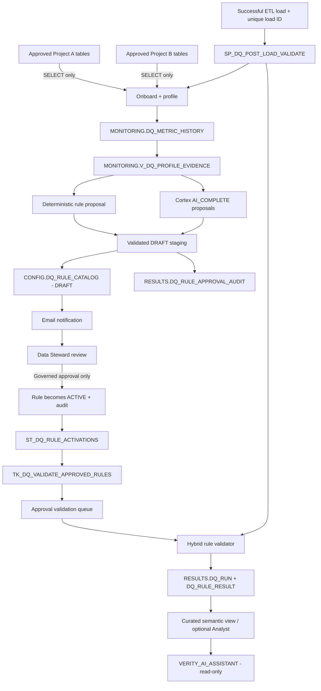
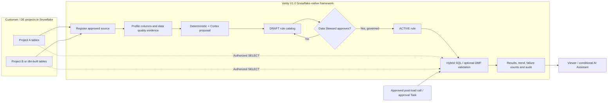

# Verity V1.0 — Snowflake Cortex AI Agent, Data Quality & Skills Design

> **Enterprise design document · Draft for architecture / security / pod-lead review**  
> **Prepared using the supplied 16-section Cortex AI Agent / Skill design template; business justification expanded for customer and Pod Lead review.**  
> **Evidence convention:** **Implemented/tested** refers to reported pilot tests or procedure definitions reviewed during Verity development. **Target/proposed** refers to intended architecture, thresholds or controls not yet verified in the new account. **TBD / evidence required** is not an approval or a passed test.

## 1. Document Information (Mandatory)

| Attribute | Details |
|---|---|
| Agent / Skill Name | **Verity V1.0 — AI-Assisted Data Quality Governance and Validation**; interactive agent name referenced in Git config: `VERITY_AI_ASSISTANT` (verify exact qualified object name from exported DDL). |
| Use Case | Centrally profile approved structured Snowflake tables, recommend DQ rules from aggregate evidence, route rules for Steward approval, validate ACTIVE rules and answer authorized questions about DQ results. |
| Document Version | **0.9.3 — Concise management problem statement; design review draft** |
| Document Status | **Draft — approval and clean-account validation pending** |
| Date | **2026-11-20** |
| Authors | Verity engineering team — individual author(s) **to be confirmed**. |
| Reviewers | **Durga** (pilot review pending, as reported); Pod Leads; Snowflake Platform/Security; Data Governance; project Data Owner — assignments/signatures pending. |
| Related References | Git `AGENTS.md`, `README.md`, `deploy/INSTALL_ORDER.md`, `deploy/deployment_manifest.json`, `config/object_manifest.json`, `docs/ARCHITECTURE_DEPLOY.md`, `docs/RBAC_AND_SECURITY_GAPS.md`, `tests/ACCEPTANCE_MATRIX.md`, exported live DDL and grant snapshots; Jira/PRD/approval URLs **TBD**. |
| Release boundary | **V1.0 structured-data pilot**. Not a production security or deployment sign-off. |

### 1.1 Review status

- The working Snowflake account has demonstrated profiling, Hybrid validation, a controlled approval flow, notifications, and manual Task execution. Statements about these demonstrations are *pilot evidence*, not clean-account certification.
- Exact live object DDL, semantic-view definition(s), interactive Cortex Agent specification, notification procedure internals and inventory must be reconciled against the Git repository before a release sign-off.
- Historical metric/run/queue data migration is **explicitly excluded** from the user's clean-deployment plan. Approved config and synthetic fixtures are deployed or regenerated afresh.

## 2. Purpose and Scope (Mandatory)

### 2.1 Business Problem — Why Verity Is Needed

**Problem Statement**

Data engineers spend significant time writing, executing, and maintaining data-quality tests. Built-in Snowflake checks do not cover every business requirement, while scaling tests across multiple projects and managing external tools increases effort and complexity.

**How Verity V1.0 solves the problem**

**Verity V1.0** addresses these challenges through a Snowflake-native, AI-assisted data-quality framework that automates profiling, recommends additional validation rules, improves test coverage, reduces manual effort, and centralizes validation and monitoring.

**Key message to management:** Verity aims to **reduce data-quality testing effort, improve test coverage, and simplify testing across multiple projects without relying on multiple external tools.**

These are the intended benefits; actual time and coverage improvements will be measured during pilot benchmarking.

#### 2.1.1 Problem-to-solution mapping

| Business pain | What happens today | Verity V1.0 response | What must be measured |
|---|---|---|---|
| Manual testing effort | Write and rerun per-table checks, inspect output individually | One onboarding/profiling flow; rule catalog; reusable Hybrid validation; post-load hook | Engineer minutes per source and per approved rule; end-to-end time to first validated run |
| Gaps in rule coverage | Focus on known technical checks; custom domain tests added unevenly | Profile TEXT/NUMERIC/DATE evidence; deterministic/Cortex DRAFT suggestions for implemented patterns; six mandatory executable rule types | Approved requirement coverage; planted defect detection/false positives by rule type |
| Poor multi-project scalability | Duplicate setup, varying definitions, scattered results | Shared CONFIG, ENGINE, MONITORING, RESULTS; per-project read-only source access | Time to onboard N tables/projects, cost per table/run, source isolation |
| Tool fragmentation | SQL, dbt, DMFs and dashboards without common governance | Snowflake-native control plane, standardized results and audit; integrate with—not necessarily replace—dbt/native DMFs | Number of manual handoffs, reporting effort, workflow adoption |
| Unreviewed rule activation | Ambiguous rule ownership and threshold changes | DRAFT-only proposals, governed Steward approval, audit and activation-triggered validation | % of active rules with approval evidence; unauthorized activation attempts denied |

#### 2.1.2 Positioning against existing tooling

| Option | Best at | Why Verity adds value / boundary |
|---|---|---|
| **Snowflake native DMFs** | Measuring many standard and specialized quality statistics inside Snowflake; custom DMFs extend coverage | **Complement, not replacement.** Verity offers project-level onboarding, profile-informed recommendations, governed approval, a common execution/result model, and human ownership. V1 Hybrid may use optional DMFs alongside SQL rules; not all DMFs are automatically orchestrated by Verity. |
| **dbt tests** | Versioned tests tied closely to transformation models and dbt CI | Verity evaluates the resulting **table data** across approved sources and tracks business-reviewed recommendations and centralized results. It does not compile dbt projects or replace `dbt test`. |
| **Manual SQL** | Highly flexible one-off validations | Verity standardizes repetitive onboarding, execution, lifecycle and reporting, while still needing SQL/rule engineering for unsupported scenarios. |
| **External DQ platforms** | Potentially broad connectors, dashboards, observability and enterprise workflows | Snowflake-native processing and control objects can simplify a Snowflake-first environment, avoid introducing another DQ execution platform, and reuse Snowflake RBAC. Evaluate actual feature parity and total cost, not assume Verity is cheaper or broader. |

**Customer-facing differentiator:** **Verity is not “more DMFs.” It is an evidence-to-decision-to-validation framework inside Snowflake, combining standard checks, supported custom SQL rules, Cortex-assisted proposals, Steward approval, shared execution, and auditable outcomes.**

### 2.2 Objectives

1. Onboard **approved, structured, read-only source tables** from **two independent pilot project database/schema locations** in the same Snowflake account.
2. Profile TEXT, NUMERIC, DATE/TIMESTAMP and key-like columns for relevant null, blank, edge-whitespace, distinct and min/max statistics.
3. Support the six mandatory engine rules: **NOT_NULL, UNIQUE, RANGE, VALUE_SET, CONDITIONAL_REQUIRED, NO_EDGE_WHITESPACE**. Additional implemented rules: **NOT_BLANK** and **UNIQUE_NORMALIZED**.
4. Stage evidence-backed recommendations as **DRAFT**. No AI recommendation may activate a rule without authorized human review.
5. Track source registration, profiles, rules, approval history, results, notifications, post-load runs and Task/queue state centrally.
6. Allow a separate Steward role to approve supported DRAFT recommendations through a governed procedure; the project execution role must not have ordinary direct activation privileges.
7. Permit CoCo to deploy the same Git release to a new account with approved parameterized values, then demonstrate full object reconciliation and reproducible tests.
8. Establish a measurable baseline for onboarding time, processing latency, failure-detection correctness, warehouse credits and AI credits. **No unmeasured time-saving percentage is claimed.**

### 2.3 Scope Definition

**In scope — V1.0:**

- Snowflake tables with structured relational columns; approved source-table SELECT only.
- Automated profiling and central evidence storage.
- Six mandatory validation rule types, plus supported pilot extensions.
- Deterministic whitespace suggestions and Cortex `AI_COMPLETE` proposals from aggregate profiling evidence; explicit rule-parameter allowlists.
- DRAFT/ACTIVE lifecycle, Steward approval and audit, notification emails, activation Stream, scheduled queue dispatcher, Hybrid rule validation and explicit ETL post-load hook.
- Semantic-view-backed, **read-only DQ monitoring questions if the exported `VERITY_AI_ASSISTANT` object and semantic configuration are verified and deployed**.
- Git/CoCo-guided deployment, parameterized RBAC, synthetic fixtures, cost/performance/negative-permission tests and source-to-target object reconciliation.

**Out of scope — V1.0:**

- JSON/VARIANT source-column profiling, unstructured/PDF retrieval and Cortex Search RAG.
- Cross-account source federation, automated remediation/deletion/updating of project source records, Streamlit dashboard, issue-ticket creation and production incident integration.
- Native dbt compilation or `dbt test` execution. Verity may validate **tables materialized by dbt**; native dbt testing remains separate.
- Automated historical run/audit/queue migration to a new account.
- Arbitrary text-to-SQL over raw project data, cross-project access without approvals, and autonomous rule activation.

### 2.4 Target Users and Personas

| Persona | Needs | Access boundary |
|---|---|---|
| Data Engineer / DE Pipeline operator | Register authorized tables, profile, validate, invoke post-load checks | `VERITY_V1_0_EXEC_DE_PIPELINE`, approved SELECT on source tables |
| Data Steward | Review evidence and approve/reject governed suggestions | `VERITY_V1_0_STEWARD`; review access plus approval procedure only |
| Data Owner | Confirm rule semantics, thresholds and business impact | Approved project context and reviewed results |
| DQ Analyst / Reader | Explore failures, trends and summaries | `VERITY_V1_0_VIEWER` and narrowly scoped semantic/Agent access |
| Platform Administrator | Deploy infrastructure, integrations, privileges | `VERITY_V1_0_ADMIN` plus accountable account-level bootstrap role |
| Scheduler service | Process approval events without a human login | `VERITY_V1_0_TASK_EXEC`, restricted source coverage |
| CoCo deployment operator | Install from Git and produce evidence | Authorized target-account role; no credentials in Git |

### 2.5 Expected Business Outcomes

The outcomes below are **hypotheses to validate**, not measured savings from the current pilot.

| Desired outcome | Business rationale | Evidence / KPI |
|---|---|---|
| **Less human time writing and maintaining tests** | More time for complex business checks and pipeline delivery | Median engineering minutes to onboard + profile + define + validate one table vs baseline manual SQL/dbt workflow; include rework |
| **Better quality-test coverage** | Fewer missed data defects before downstream consumption | Approved requirements exercised ÷ total identified approved requirements; defect detection and false-positive rates |
| **Faster repeat validation** | Easier regression checks after ETL/dbt loads | End-to-end elapsed validation time, p50/p95 per row-volume tier; separately measure human approval wait |
| **Scalable multi-project consistency** | Less duplicated setup across teams | Sources onboarded and actively monitored per project; per-source configuration effort; normalized result definitions |
| **Reduced tool fragmentation** | One operational view of source registration, proposals, results and audit | Number of manual handoffs and separately maintained result repositories; qualitative operator feedback |
| **Stronger governance** | Rule changes are reviewable and accountable | 100% of AI-originated ACTIVE rules have Steward approval reason and audit event; no unapproved activation |
| **Snowflake-aligned operational model** | Reuse Snowflake roles, warehouse, tables, Tasks, Streams and Cortex where available | Project SELECT-only security tests; warehouse/AI credits per workflow; actual operating-cost comparison |
| **Repeatable installation** | Deploy the same reviewed implementation to a new account | 100% object-manifest reconciliation and end-to-end acceptance under dedicated roles |

### 2.6 Assumptions, Dependencies, and Constraints

- Snowflake account supports the required Cortex model and Agent/semantic features in its region/edition, subject to actual entitlement checks.
- Operators authenticate through authorized Snowsight, Snowflake client/CLI or approved CoCo tooling; new-account secrets and credentials live outside Git.
- Project tables are in the same account for V1.0; source SELECT privileges are explicitly granted.
- `VERITY_V1_0` / `VERITY_V1_0_WH` are the **current as-built names**. Existing procedure SQL hardcodes the database name; arbitrary database renaming requires tested SQL refactoring, not YAML substitution alone.
- Task cannot assume access to every possible project source. The shared approval queue must enforce eligible source/role authorization before unattended scheduling.
- User confirmed **no historical data backup/migration** is required for clean deployment; table structures and test fixtures remain required.
- New-account automatic deployment is not yet proven; the v3 kit currently renders part of the configuration and needs complete recovered DDL and a validated executor.

### 2.7 Business-Value Benchmark Method (Proposed)

1. Select the same representative table and **approved requirement list** for both approaches (manual SQL/dbt/native DMF baseline versus Verity). Use a clean environment and record which checks are already authored, reused, or newly created.
2. Time each human step: schema investigation, rule design, SQL/config authoring, debugging, review, change maintenance, and result interpretation. Do not confuse **human effort** with compute execution time.
3. Independently capture query/runtime duration, warehouse credits, Cortex credits/tokens, and scheduling overhead for Verity. Compare like-for-like row volumes and include setup/idle costs.
4. Seed known null, duplicate, invalid range, unsupported status, conditional-required, and edge-whitespace defects. Count correctly detected requirements, false positives, and unsupported scenarios in both systems.
5. Repeat at 1K / 100K / 1M rows across **two independent project locations**, and publish measured values with caveats. The customer-specific 40/60 example should be replaced by the resulting requirement coverage matrix.

**Suggested formulas** (report measured numerators/denominators):

- **Requirement coverage (%)** = implemented, approved and successfully executed checks ÷ approved requirement inventory × 100.
- **Human-effort reduction (%)** = (baseline engineer minutes − Verity engineer minutes) ÷ baseline engineer minutes × 100.
- **Automation elapsed time** = profiling + proposal generation + validation processing, recorded separately from approval wait.
- **Cost per validation run** = attributable warehouse credits + Cortex/service usage, with unallocated warehouse idle time identified separately.

**Acceptance principle:** A speed or coverage advantage is not claimed until independently measured against an equivalent baseline; Verity's governance value can still be assessed qualitatively even when raw SQL runtime is similar or slower.

## 3. Core Architectural Principles (Mandatory)

| Principle | Verity treatment | Status |
|---|---|---|
| Security by Design | Controlled onboarding, restricted roles, input and rule contract validation | **Partially implemented; hardening pending** |
| Least-Privilege Access | Distinct Admin, Runtime, Steward, Viewer, Task service; source SELECT only | **Pilot-tested; catalog writes need hardening** |
| Data Privacy and Governance | Cortex receives **aggregated profile metrics**, not raw rows by design; mask/restrict sensitive attributes in semantic outputs | **Design; verify all prompt/query paths** |
| Separation of Context | Agent behavior/context kept in a separately versioned `.md`, optionally published to a controlled Snowflake internal stage | **Proposed; stage linkage not yet demonstrated** |
| Reusability and Modularity | Independent objects and parameterized Git templates; procedures return VARIANT status contracts | **Implemented in pilot** |
| Configuration over Hardcoding | YAML/JSON for roles, users, warehouse, integration, model, project sources | **Partial: SQL FQNs not all parameterized** |
| Scalability/Reliability/Maintainability | Batch Hybrid SQL, approval queue, retry/dead-letter tracking | **Pilot-tested; stale PROCESSING recovery and stress tests pending** |
| Observability/Auditability | Metric history, run/results, DRAFT/ACTIVATED audit, queue, notification log, Task history | **Implemented; alerting review pending** |
| Cost/Performance Optimization | X-Small warehouse, consolidated validation, prefilter candidate evidence, model configuration | **Costs observed; limits and benchmarks pending** |
| Human-in-the-Loop | Human Steward approval required for supported AI-proposed rule activation | **Tested for supported rule types** |

**Deviation:** The pilot needed direct `INSERT` on `CONFIG.DQ_RULE_CATALOG` and `INSERT/UPDATE` on `CONFIG.DQ_SOURCE` for caller's-rights onboarding. These are **temporary, non-production grants**. Owner's-rights procedures currently have incomplete per-project source authorization. Do not present the current RBAC as production-hardened.

## 4. Tools and Technologies (Mandatory)

| Component category | Selected technology | Purpose / rationale |
|---|---|---|
| Snowflake Cortex AI | `AI_COMPLETE` through `SP_DQ_GENERATE_AI_RECOMMENDATIONS`; current source model `llama3.3-70b` | Suggest allowlisted DQ rules using aggregate evidence; model availability to be verified per account |
| Interactive AI | Cortex Agent `VERITY_AI_ASSISTANT` (actual DDL **to be reconciled**) | Read-only natural-language DQ analysis, grounded in approved semantic assets |
| Cortex Analyst | Semantic view(s) **if exported Agent uses Analyst/semantic tools** | Authorized text-to-SQL over curated DQ metrics, never unrestricted project data |
| Compute / Orchestration | Snowflake SQL stored procedures, scheduled Task, Stream, queue table; `VERITY_V1_0_WH` | Snowflake-native execution; one-minute approval Task configured, initially suspended on installation |
| Data Storage / Modeling | Ordinary structured Snowflake tables and views in CONFIG, ENGINE, MONITORING, RESULTS, PRACTICE | Stable catalog, metrics, audit, run and result contracts |
| Integration / APIs | Snowflake email notification integration `VERITY_V1_0_EMAIL_INT` and `SYSTEM$SEND_EMAIL` if present in exported notification procedure | Notify verified Steward recipients; notification does not constitute approval |
| Git / Automation | Git, `AGENTS.md`, config renderer, manifest, release gate, CoCo-assisted deployment | Reproducible deployment; no automated one-command installer proven yet |
| External Tools (optional) | dbt upstream project, if present | dbt materializes tables; Verity profiles/tests resulting Snowflake tables |
| Not selected for V1.0 | Cortex Search, external vector databases, external APIs, Streamlit | Outside structured-data pilot scope |

## 5. Cortex Analyst Design (Optional — Applies If Agent Uses a Semantic View)

> **Conditional:** The repository references semantic views and `VERITY_AI_ASSISTANT`, but the exact deployed semantic model, verified queries and Agent tool wiring were not provided in this review. Do not infer that Analyst-based Q&A is already accepted.

### 5.1 Supported Business Questions

Proposed read-only questions:

- "Which approved sources had the most failed DQ rules in the last seven days?"
- "Show failure percentage by rule type for the latest completed run."
- "Which sources have DRAFT recommendations waiting for Steward review?"
- "How many approval-triggered validations completed or retried today?"
- "What profile evidence supports the recommendation for COLUMN_X?"

### 5.2 Semantic Model Definition

| Item | Design |
|---|---|
| Database / Schema | `VERITY_V1_0.MONITORING` (target; confirm exported qualified semantic view) |
| Tables / Views | `CONFIG.DQ_SOURCE`, `CONFIG.DQ_RULE_CATALOG`, `MONITORING.DQ_METRIC_HISTORY`, `MONITORING.V_DQ_PROFILE_EVIDENCE`, `RESULTS.DQ_RUN`, `RESULTS.DQ_RULE_RESULT`; curated read-only views preferred |
| Dimensions | Source, project/schema, rule, rule type, column, severity, run date/time, status |
| Measures | Total validated records, failed records, failure %, active/draft rule count, pass/fail rule count, run count, profile null/blank/whitespace counts |
| Repository location | `sql/09_semantic_views/live/` for original SQL; versioned verified-query fixtures under `tests/agent/` (**to create**) |
| Model definition | Exact live semantic view DDL; **not reconstructed from assumptions** |

### 5.3 Relationships and Terminology

- `DQ_SOURCE.SOURCE_ID` identifies registered source; `DQ_RULE_CATALOG.SOURCE_ID` links rules.
- `DQ_RUN.RUN_ID` links one validation run to many `DQ_RULE_RESULT` records.
- "Failed rows" vs "failed rule evaluations" must remain distinct; do not sum per-rule failed rows as a unique record count without a valid deduplication method.
- "Latest" must use completed run/profile ordering and eligible statuses, not arbitrary `MAX` without the correct partition.

### 5.4 Verified Queries

Create SQL golden queries for: latest source run, latest profile run, rule failure percentage, ACTIVE vs DRAFT counts, approval latency and queue retry/dead counts. Compare Agent-generated outputs to exact SQL results. Store in `tests/agent/verified_queries.sql` (**proposed path**).

### 5.5 Known Limitations & Accuracy Requirements

- No direct answers from raw unapproved project tables. Cross-project aggregation must respect the invoking user's permissions.
- Semantics of thresholds, failure percentages and duplicated rows require published business definitions.
- Proposed acceptance: **100% SQL numerical agreement on the release golden-query set**, no unauthorized row disclosure, clear fallback for unavailable data. A broader natural-language accuracy threshold must be established and signed off; no measured accuracy is available yet.

### 5.6 Access Control & Performance

Use Viewer/Steward-approved access paths, read-only semantic assets and SELECT-limited underlying objects. No arbitrary SQL execution or write procedure as an Agent tool. Profile result query times and Agent response latency separately; verify roles and Cortex Agent privileges in the new account.

> **Section 6, Cortex Search Design, intentionally omitted:** Verity V1.0 is structured-data focused and does not use RAG over unstructured documents.

## 7. Functions and Extensions (Optional — Applicable)

| Function / tool | Purpose | Input | Output | Security / effect |
|---|---|---|---|---|
| `SP_DQ_ONBOARD_TABLE` | Discover/record source, prepare baseline rules | `P_TABLE_FQN VARCHAR` | VARIANT status + source ID | Caller rights in current pilot; requires review of source authorization and catalog writes |
| `SP_DQ_PROFILE_TABLE` | Profile approved table | `P_TABLE_FQN VARCHAR` | VARIANT + profile run ID | Reads source, writes metrics; verify full DDL |
| `SP_DQ_AUTO_STAGE_PROFILE_DRAFTS` | Deterministic edge-space DRAFTs | `P_SOURCE_ID NUMBER` | VARIANT draft counts | **Owner rights**; calls controlled staging procedure |
| `SP_DQ_GENERATE_AI_RECOMMENDATIONS` | Cortex evidence-based rule suggestions | `P_SOURCE_ID NUMBER` | VARIANT AI call and draft counts | Requires Cortex model/function access; original DDL to verify |
| `SP_DQ_STAGE_AI_RECOMMENDATION` | Validate AI proposal and insert DRAFT + audit | source, column, type, VARIANT params, profile ID, reason | VARIANT `DRAFT_CREATED`/rejection | **Owner rights**; allows `NO_EDGE_WHITESPACE`, `NOT_BLANK`, `UNIQUE_NORMALIZED` |
| `SP_DQ_ONBOARD_AND_NOTIFY_AI` | End-to-end onboarding orchestration | table FQN, Steward email | VARIANT stage statuses | **Caller rights**; nested procedure privileges required |
| `SP_DQ_NOTIFY_DRAFT_RULES` | Email Steward about proposals | source ID, email | VARIANT notification status | Execution context / integration grants need verified live DDL |
| `SP_DQ_APPROVE_PROFILE_RULE` | Human approval of supported DRAFT | rule ID, reason | VARIANT `ACTIVE`/`REJECTED` | **Owner rights**; only 3 listed proposal types, requires validated intake audit |
| `SP_DQ_EXECUTE_HYBRID_V1_0` | Validate ACTIVE rules | table FQN | VARIANT run ID, counts, status | **Caller rights**; approved source SELECT and results write |
| `SP_DQ_PROCESS_APPROVAL_VALIDATIONS` | Consume approval Stream; queue/retry; validate | none | VARIANT queue/validation counts | **Caller rights**; runs under Task owner role |
| `SP_DQ_POST_LOAD_VALIDATE` | Reprofile/validate after ETL load | table FQN, external load ID | VARIANT execution outcome | Explicit pipeline hook; idempotency requires unique load ID |

**Important capability distinction:** The Hybrid engine implements the mandatory six validation rule types; the **reviewed** `SP_DQ_APPROVE_PROFILE_RULE` permits activation only for `NO_EDGE_WHITESPACE`, `NOT_BLANK` and `UNIQUE_NORMALIZED`. How the six mandatory types are created/activated must be separately documented and tested. Do not conflate engine rule support with AI approval support.

**Error handling and dependencies:** Procedures return explicit `DONE`, `DONE_WITH_DQ_FAILURES`, `DONE_WITH_AI_WARNING`, `REJECTED`, `STOPPED_*` or `ERROR` statuses as applicable. Snowflake Task `SUCCEEDED` alone does not prove application-level success; inspect queue, run and audit records. Queue retries/dead-letter handling exists; stalled `PROCESSING` recovery is a known improvement.

## 8. Overall Architecture (Mandatory)

### 8.1 Logical Architecture — How Verity Solves the Business Problem

Verity uses **Snowflake as the main execution and governance environment**. Project data remains in approved Snowflake source tables during SQL validation; profiling-derived aggregates feed the recommendation pathway, rather than a default external full-row extraction workflow. This is an architectural aim to validate for each Cortex/notification integration, **not a blanket assertion that no information leaves the Snowflake platform**.

| Architectural layer | Snowflake components | Business problem solved |
|---|---|---|
| **Project source layer** | Approved relational tables from Project A and Project B; optional dbt-materialized tables | Avoid project-specific data duplication; use per-project SELECT-only boundaries |
| **Onboarding / control plane** | `CONFIG.DQ_SOURCE`, `CONFIG.DQ_RULE_CATALOG`; onboarding procedure | Remove repetitive registration, standardize rule definitions and ownership |
| **Profiling / evidence layer** | `SP_DQ_PROFILE_TABLE`, `MONITORING.DQ_METRIC_HISTORY`, `V_DQ_PROFILE_EVIDENCE` | Surface data characteristics and possible gaps before tests are hand-authored |
| **Recommendation layer** | Deterministic policy, Cortex `AI_COMPLETE`, `SP_DQ_STAGE_AI_RECOMMENDATION` | Propose supported tests from evidence, reducing manual discovery; proposals are not automatically correct |
| **Governance layer** | DRAFT rules, notification integration, Steward-approved activation, `DQ_RULE_APPROVAL_AUDIT` | Apply human judgment to customer-specific business semantics and preserve auditability |
| **Execution layer** | `SP_DQ_EXECUTE_HYBRID_V1_0`, SQL rules and optional Snowflake DMF path; post-load hook | Reuse standardized validation across supported rule types without rewriting each run |
| **Orchestration layer** | `ST_DQ_RULE_ACTIVATIONS`, Task, queue/retry tracking | Trigger validation after approval and keep repeated checks operationally consistent |
| **Observability / read plane** | `DQ_RUN`, `DQ_RULE_RESULT`, notification/queue history; semantic views / conditional `VERITY_AI_ASSISTANT` | Consolidate failure metrics and lineage of quality decisions across projects |
| **Delivery plane** | Git `AGENTS.md`, config templates, object manifest, CoCo deployment process | Reproduce the framework for a new account instead of manual worksheet recreation |

**Separation of responsibilities:** Data Engineers run profiling and validations; Data Stewards approve proposed rules; Platform Administrators provision infrastructure; a technical Task service role processes the shared approval queue; Viewers/Agent users see only authorized results.

**Execution reality:** Current Hybrid validation supports six mandatory rule types and pilot extensions. The DMF path is optional; many checks use SQL. The approved AI proposal and Steward-approval contracts currently cover a narrower subset. Verity is **not** a generic LLM that writes arbitrary SQL and executes it without review.

### 8.2 Data and Control Flow

Flow specifics:

1. Administrator approves and grants source-table access to a project execution role.
2. Runtime onboards the table and profiles it, writing aggregate metrics.
3. Deterministic and Cortex paths propose a limited, validated set of DRAFT rules; notify a verified Steward.
4. Steward reviews evidence, parameters and business semantics, then invokes approval with a documented justification.
5. Activation audit is captured by the Stream; a scheduled Task batches approvals, invokes the Hybrid validator and persists technical/DQ outcomes.
6. On later successful ETL commits, pipeline invokes post-load validation with a stable unique load ID.
7. Authorized analysts inspect curated results; Agent answers questions only where its actual deployed semantic access supports them.

### 8.2.1 Business workflow illustrated

This flow supports three complementary outcomes: **faster configuration** through reuse and proposals, **broader test coverage** through systematic profiling plus business-reviewed rules, and **less tool fragmentation** through central Snowflake-native results. Performance gains and coverage improvements must be demonstrated with the Section 2.7 benchmark.

### 8.3 Authentication, Authorization & Integration

- Snowflake RBAC: `VERITY_V1_0_ADMIN`, `VERITY_V1_0_EXEC_DE_PIPELINE`, `VERITY_V1_0_STEWARD`, `VERITY_V1_0_VIEWER`, `VERITY_V1_0_TASK_EXEC` (fifth is a technical Task role, not a separate business persona).
- Task ownership reported transferred to `VERITY_V1_0_TASK_EXEC`; manual `EXECUTE TASK ... AWAIT` returned `SUCCEEDED`. **Automatic recurrence remains a separate acceptance test.**
- Dedicated project roles receive only approved source-table SELECT grants and framework operation permissions.
- Use approved Snowflake login / key-pair / OAuth connection configured outside Git for CoCo or CI; no shared passwords or private keys in source control.
- Email integration `VERITY_V1_0_EMAIL_INT` must be provisioned with allowed verified recipients in each account.
- Cortex access requires appropriate database-role and `USE AI FUNCTIONS`/per-function privileges, plus model availability. Do not assume default `PUBLIC` access is an enterprise security policy.

### 8.4 Architecture Diagram

The Mermaid flowchart above is the required editable architecture diagram. Render in GitHub Markdown or your approved architecture publishing tool; maintain a source-controlled image export only if required for the review package.

## 9. Agent or Skill Design (Mandatory)

### 9.1 Supported Intents and Tasks

**Agent read-only intents (conditional on verified Agent/semantic deployment):** summarize DQ health, explain failure counts and percentages, compare recent runs, list DRAFT/ACTIVE rules, explain profile-based recommendation evidence, identify queue retries/failures, provide grounded next steps for responsible humans.

**Workflow procedures (outside autonomous Agent permissions):** onboarding, profiling, staging, Steward approval and validation remain controlled SQL operations. **Agent may explain how to call them; no Agent write tool is enabled in V1.0 by default.**

### 9.2 Prompt and Instruction Strategy

- Persona: conservative internal data-quality analyst, not an operator with unrestricted authority.
- Source of truth: governed semantic views, permitted aggregates and exact registered metadata.
- Never fabricate source IDs, rule IDs, statuses, results, record counts or SQL query IDs.
- Distinguish SQL execution error from a DQ-rule failure; report metric definitions and time filters.
- Explain why an AI suggestion is only a proposed DRAFT; Steward approval is mandatory.
- Do not show raw PII, secrets or unauthorized cross-project details; no prompt should override Snowflake RBAC.
- Link to existing audit/run identifiers where available; do not claim evidence when unavailable.

**Companion context file:** `docs/agent/VERITY_AI_ASSISTANT_CONTEXT.md` (version-controlled draft to be published to a locked-down internal stage only if the actual Agent configuration consumes it). The Git deployment manifest must describe how this file is uploaded and linked; **this step is not confirmed implemented**.

### 9.3 Tool-Selection Rules

1. For status/count/trend questions, query only approved semantic/DQ reporting views.
2. For procedural how-to, return documentation; do **not** call write procedures.
3. For questions about a particular rule/run/source, require a resolvable authorized identifier.
4. If project scope is not authorized, refuse to retrieve it; do not attempt fallback direct SQL against raw project tables.
5. If semantic tool or evidence is unavailable, respond with a transparent limitation.

### 9.4 Context and Conversation Management

- Agent instructions are versioned separately from semantic model definitions.
- Default is request-scoped context; persisted conversation history and retention policy **TBD** in the actual exported Agent implementation.
- Avoid passing raw project rows or a full historical queue to the LLM; return compact, scoped aggregates and query-result references.

### 9.5 Handling Ambiguity and Exceptions

Ask for a source/rule/date filter when essential; otherwise state the interpreted default and evidence. Provide a safe fallback for zero available metrics, missing profile runs, unsupported rule types, Cortex model unavailability, DQ engine `ERROR` and notification failure. Never convert `DONE_WITH_DQ_FAILURES` into a technical failure claim.

### 9.6 Response Formatting and Grounding

Proposed format: **scope**, **as-of time**, **metric**, **value**, **interpretation**, **evidence/run ID**, **action requiring Steward review**. Numeric statements must be reproducible from curated Snowflake SQL. No unrestricted SQL or unsupported causal claims.

## 10. Configuration and Customization (Mandatory)

### 10.1 Environment Settings

- Environment: development / QA / production; distinct target Snowflake accounts or namespaces.
- Parameters stored in `config/verity.example.yaml` and `config/verity.deployment.example.json`; actual local config excluded from Git.
- Connection/authentication handled by approved Snowflake/CoCo profile outside source control.
- `{{ ... }}` placeholders are rendered to validated SQL identifiers/values; unresolved placeholders block execution.
- Current V1.0 enforces the as-built database/warehouse names until all original procedure FQNs have been safely refactored.

### 10.2 Customization Parameters

| Parameter | As-built / proposed default | Allowed values / validation | Deployment status |
|---|---|---|---|
| `database` | `VERITY_V1_0` | Must match as-built DDL until refactored | Frozen in v3 |
| `warehouse` | `VERITY_V1_0_WH` | Safe Snowflake identifier | Configurable within validated renderer |
| `warehouse_size` | `XSMALL` | Account-supported warehouse sizes; platform-approved | Configurable |
| `roles.admin/runtime_project_de/steward/viewer/task_service` | Corresponding Verity role names | Safe validated role identifiers | Configurable |
| `bootstrap.grant_admin_to_current_user` | `false` | Boolean, authorized operator only | Configurable |
| `role_assignments` | No users by default | Existing approved users in target account | Configurable |
| `project_sources[].approved` | `false` | Explicit admin-approved true to grant SELECT | Configurable |
| `cortex.recommendation_model` | `llama3.3-70b` from pilot | Account/region-supported model | Configurable name; procedure coupling to verify |
| `cortex.interactive_agent` | `VERITY_V1_0.MONITORING.VERITY_AI_ASSISTANT` (config example) | Actual qualified Agent object | DDL verification required |
| `notifications.integration` | `VERITY_V1_0_EMAIL_INT` | Account integration name | Configurable; live definition review |
| `notifications.verified_recipient` | No real recipient in Git | Verified/allowed target-account address | Must be configured |
| `scheduled_task.schedule` | `1 MINUTE` | Approved Snowflake schedule | Configurable after Task DDL review |
| `scheduled_task.enabled_on_install` | `false` | Boolean | Must remain false until release gates pass |
| `max_queue_retries` | 3 reported in current dispatcher | Proposed 1–5 after code refactor | **Currently hardcoded; not YAML-controlled** |
| `ai_cost_limit` / `cost_alert_threshold` | **Not implemented** | Finance/Platform-approved budget | Proposed guardrail, not enforced |

### 10.3 Secrets Management

Keep passwords, private keys, tokens and OAuth credentials out of Git. Use Snowflake-approved authenticators, secrets management and restricted connection profiles. Commit only `.example` configuration, sanitized fixture datasets and parameter templates. Recipient addresses may be personal data; limit access in Git and config artifacts.

### 10.4 Boundaries

**Customizable:** environment, approved table list, assigned usernames, role naming, warehouse size, schedules, supported model/integration, alert recipients and supported business rules after governance review.

**Not customizable by a project user:** human approval requirement, source-table write prohibition, catalog activation gateway, audit logging, cross-project authorization, security-critical validation contracts and secret-handling requirements.

## 11. Security, Governance, and Guardrails (Mandatory)

### 11.1 Access Control (RBAC/ABAC)

| Role | Allowed responsibility | Forbidden / caution |
|---|---|---|
| `VERITY_V1_0_ADMIN` | Reviewed deployment and lifecycle administration | Not used for routine DQ or business approvals |
| `VERITY_V1_0_EXEC_DE_PIPELINE` | SELECT approved source tables; profile/run/post-load; controlled DRAFT submission | No free-form `ACTIVE` insert/update or cross-project grants |
| `VERITY_V1_0_STEWARD` | SELECT proposals/evidence; call owner's-rights approval | No direct `UPDATE` to catalog; no project source write |
| `VERITY_V1_0_VIEWER` | SELECT authorized monitoring and results | No INSERT/UPDATE/DELETE |
| `VERITY_V1_0_TASK_EXEC` | Own/execute shared scheduled approval Task and approved queue processing | No blanket SELECT on all projects; source-scoping must be enforced |

**Known open gap:** The caller's-rights `SP_DQ_ONBOARD_TABLE` required pilot direct `INSERT` on `DQ_RULE_CATALOG` and `INSERT/UPDATE` on `DQ_SOURCE`. A runtime user with direct catalog INSERT could create an ACTIVE row outside the intended approval path. Before production, replace this with controlled permission delegation and revoke direct catalog INSERT. Owner's-rights proposal staging must also enforce project/source authorization; simply switching high-privilege owner modes is insufficient.

### 11.2 Data Protection & Privacy

- Programmatic AI proposals use aggregate profile evidence; never send raw rows, passwords, email contents or unmasked source PII in prompt construction.
- Profiling counts may disclose business-sensitive aggregates: apply source-level authorization, restrict semantic models and avoid exposing unapproved project identifiers.
- Use Snowflake masking/row access policies as required by data classification; **none are asserted as deployed from the reviewed evidence**.
- Define retention policies for metrics, approval audit, emails and Agent traces before production.

### 11.3 AI Specific Guardrails

- Model output is untrusted; allowlisted types and exact JSON contracts are validated by `SP_DQ_STAGE_AI_RECOMMENDATION`.
- Profile evidence and currently enabled table are required; duplicate DRAFT/ACTIVE rules are checked.
- Activation requires governed human action with reason and DRAFT audit evidence.
- Agent is read-only and cannot invoke arbitrary SQL/DDL/DML or auto-approve rules.
- Guard against prompt injection from source metadata/comments; ignore attempts to override system instructions or impersonate an approver.
- Enforce Cortex model/function permissions in role design; model availability and regional constraints must be checked.
- **Cost guardrail status:** Spending limits, Cortex per-role restrictions and hard-stop budget controls are **not yet demonstrated**. Propose explicit operator-approved caps, alerting and throttling; do not assert they exist.
- Content filtering / Cortex Guard usage: **TBD — not evidenced in as-built exports**. Use only if required by enterprise risk assessment.

### 11.4 Resource Limits

- Warehouse `XSMALL` pilot; auto-suspend and resource monitor properties must be read from exported warehouse DDL.
- Constrain parallel profiling, dynamic SQL, row scans and Task scheduling; test large table behavior before production.
- Rate-limit/model-limit AI recommendations by source/column and aggregate-only prompt size; verify model token budget/cost in QA.
- Avoid enabling the 1-minute Task until least-privilege, authorization and credit monitoring gates pass.

### 11.5 Audit Logging

Evidence locations: `DQ_RULE_APPROVAL_AUDIT` (`DRAFT_CREATED`, `ACTIVATED`), `DQ_RULE_NOTIFICATION_LOG`, `DQ_APPROVAL_VALIDATION_QUEUE`, `DQ_RUN`, `DQ_RULE_RESULT`, `DQ_POST_LOAD_RUN`, `DQ_VALIDATION_RECOVERY_AUDIT`, Task history and Snowflake query history. Future Agent observability should be verified against the actual deployed Agent and Snowflake observability configuration; avoid promising prompt/trace retention without policy approval.

## 12. Testing and Validation (Mandatory)

### 12.1 Testing Strategy

| Level | Required tests | Pilot evidence / pending |
|---|---|---|
| Unit/contract | Identifier validation; allowlist/params; DRAFT-only insert; rejection statuses; approval-reason rule | Selected staging/approval procedure DDL reviewed; automate negative cases |
| Functional DQ | All six mandatory rule types, plus NOT_BLANK/UNIQUE_NORMALIZED | Hybrid tested on synthetic and external source; full new-account matrix pending |
| Profiling | TEXT, NUMERIC, DATE/TIMESTAMP, key patterns; null/blank/whitespace/distinct/min/max | Selected TEXT/numeric evidence; DATE acceptance pending |
| Integration | New source → profile → deterministic/AI DRAFT → email → Steward approval → Stream → queue → Hybrid results | Integrated pilot steps reported/tested; new account pending |
| Post-load | Unique load ID, retry/idempotency and changed ACTIVE rule set | Pilot tested; clean-account assertions pending |
| Agent/prompt | Verified numeric answers, unavailable data fallback, refusal of unauthorized scope, hallucination tests | Agent deployment and tests pending verification |
| Security | Project SELECT-only, Viewer denial of write, Steward denial of direct UPDATE, no bypass of human approval, Task source scope | Several role checks tested; production hardening outstanding |
| Performance/cost | 1K / 100K / 1M rows; p50/p95; warehouse and AI credits per workflow | Benchmark required; pilot cost figures not directly comparable |
| **Business-value benchmark** | Paired manual SQL/dbt/DMF vs Verity workload; measure engineering minutes, requirement coverage, detection accuracy, manual handoffs and credit usage | **Not yet measured; no verified 40/60 baseline or percent time-saving claim** |
| Deployment | Clone → config render → release gate → exact DDL deploy → inventory diff → all tests | v3 renderer/tests exist; executor and clean-account deployment pending |

### 12.2 Acceptance Criteria

**Release-blocking criteria** (proposed; review and sign-off required):

1. **100%** manifest-required objects exist with confirmed signatures and definitions; **zero** unresolved SQL placeholders; no silent skipped DDL.
2. All six mandatory DQ rule types detect injected known violations with expected counts and do not fail clean controls.
3. Two independent authorized project database/schema locations onboard and validate successfully.
4. AI proposal service writes **DRAFT only**; only governed Steward approval can activate; audit contains the approving user and reason.
5. Dedicated runtime and Task roles can operate with secondary roles disabled; no access to unapproved source tables.
6. Viewer cannot write; Steward cannot directly update catalog; runtime cannot insert ACTIVE rules.
7. Approval Stream/Task completes and resulting queue rows reach DONE; retry/dead paths and application-level procedure results are observable.
8. Post-load idempotency proven for repeated load ID and revalidation proven for new load ID.
9. Notification accepted through configured integration and a verified recipient; distinguish acceptance from actual recipient delivery.
10. Agent answers the verified numeric SQL golden set exactly and does not leak unauthorized project information (conditional on interactive Agent in scope for release).
11. Performance and cost baseline recorded, limits approved and operating runbook accepted; no unmeasured speed/cost promises.
12. Account-specific deployment completed by authorized CoCo/operator with source-to-target inventory reconciliation and review sign-off.

## 13. Observability and Operations (Mandatory)

### 13.1 Monitoring Metrics

| Dimension | Metrics / sources |
|---|---|
| Usage | Sources onboarded, profiling runs, validation runs, ACTIVE/DRAFT counts, Agent queries if Agent deployed |
| Quality | Failed-rule count, failing records %, trend by rule/source/date, rejected AI proposals |
| Reliability | Technical errors, `DONE_WITH_DQ_FAILURES` vs `ERROR`, queue retries/dead/stale PROCESSING, Task run state |
| Performance | Profiling elapsed time, Hybrid query count/time, approval-to-validation latency, Agent response p50/p95 |
| Cost | Warehouse credits, query execution attribution, Cortex AI credits/tokens, idle Task overhead, cost per source/run |
| Governance | Proposal approvals, time to approval, unauthorized invocation attempts, direct-DML denial checks |

**Existing development benchmark supplied by the team:** approx. **34.51 X-Small warehouse credits** and **0.009 AI credits** for the reported development/testing period. These are *not per-table costs* and cannot prove ROI or unit economics without timestamped workload attribution.

### 13.2 Dashboards and Alerts

- Snowsight SQL dashboards / authorized semantic queries; **no Streamlit dashboard in V1.0**.
- Proposed alerts: Task failure, queue DEAD or growing RETRY backlog, delayed profiling, notification errors, abrupt DQ failure spike, sustained credit increase and AI expenditure threshold breach.
- Alert thresholds are **proposed and awaiting operating baseline**; avoid asserting automatic pager integration.

### 13.3 Maintenance

- Version procedures, semantic views, Agent context and approved rule configurations in Git.
- Re-run golden-query tests after semantic model changes.
- Review AI model availability/lifecycle and per-role privileges on every new account.
- Preserve Stream offsets and queue state on an existing account upgrade; **fresh deployments start with empty queues**.
- Capture backup of DDL before changing object ownership or recreating Tasks.
- Regularly review approval/notification logs and roles for least privilege.

## 14. Deployment and Release Management (Mandatory)

### 14.1 Environment Strategy

- Dev: synthetic fixtures, limited credits, test email recipients, suspended Task by default.
- QA: two independent approved project schemas, golden DQ and Agent tests, restricted role isolation, cost benchmark.
- Prod: approved live DDL, separate project grants, reviewed runbook, monitoring, resource controls and explicit Task resume.
- First new-account deployment preserves original `VERITY_V1_0` names unless the whole SQL inventory is parameterized and retested.

### 14.2 CI/CD Pipeline

1. Git clone v3 kit and add **actual exported source SQL** one object per file under `sql/**/live/`. A raw combined `GET_DDL('DATABASE'...)` snapshot is recovery evidence, not a substitute for manifest-required individual files.
2. Run offline lint, config renderer, object inventory comparison and `scripts/release_gate.py`. Unresolved live DDL or RBAC gaps block promotion.
3. Authenticate an approved CoCo/runner via Snowflake configuration stored outside Git.
4. Deploy in dependency order: roles → warehouse/database/schemas → tables/sequences → fixtures → views → procedures → approval Stream → Task (suspended) → semantic views → Cortex Agent → email integration → grants/ownership → synthetic seeds → validations.
5. Reconcile exact object list and grants, then execute profiling, DQ, approval, notification, post-load and Task tests. Do not auto-resume the shared Task until authorized source coverage and operational controls pass.
6. Record new-account evidence, approvers, errors and exceptions in `release/EVIDENCE_AND_SIGNOFF.md`; publish a signed Git release tag only after gates pass.

**CoCo instruction:** Read `AGENTS.md` and deployment manifest; refuse to invent missing DDL, fake successes or bypass source/approval guardrails. The v3 kit is **not yet a tested one-command installer**; configuration rendering alone does not deploy to Snowflake.

### 14.3 Rollback Strategy

- Use Git tag/version rollback for procedure/Agent/semantic SQL; preserve previous exact DDL.
- Keep Tasks suspended during release and rollback; resume only through an approved change step.
- Avoid blind `CREATE OR REPLACE` of shared warehouses, event Streams or Tasks, which may disrupt state and ownership.
- For first-time clean deployments, roll back in reverse dependency order **only if it is safe** and preserve failure evidence.
- For upgrades, define stateful migration scripts, test before dropping/replacing tables, and verify whether existing queues/Streams require offset preservation.

## 15. Risks and Architectural Decisions (Mandatory)

### 15.1 Key Architectural Decisions (ADRs)

| Decision | Rationale | Alternatives considered |
|---|---|---|
| Snowflake-native DQ engine | Reuses governed warehouse/security, central audit | Separate ETL-owned SQL jobs; external DQ SaaS |
| Complement rather than replace Snowflake DMFs/dbt | Built-in and custom DMFs/dbt remain useful for certain tests; Verity adds evidence, approvals, centralized lifecycle and orchestration | Reimplementing all DMFs in Verity or claiming that dbt/external tools are obsolete rejected |
| Structured tables first | Bounded scope for pilot | Unstructured/VARIANT and federation deferred |
| Central rule catalog | Shared governance and comparable results | Per-project dbt-only rule definitions |
| Cortex proposals as DRAFT | Safe decision support; human rule semantics retained | Automatic activation rejected |
| Strict rule parameter allowlist | Prevent unsupported or ambiguous AI SQL execution | Free-form LLM-generated SQL rejected |
| Owner's-rights governed approval | Delegate narrow activation without direct Steward DML | Caller-rights with broad update rejected |
| Separate Task service role | Shared queue can cross projects; isolated operational identity | DE runtime as Task owner not selected for shared scheduler |
| Email-only notification | Low deployment complexity, audit trail | Approval-by-email and ticketing deferred |
| Git + CoCo deployment | Portable, reviewable implementation | Manual copied worksheet-only deployment |
| No historical data migration | Clean start in new account; avoids replaying old queue/audit state | Full account-state migration intentionally excluded |

### 15.2 Risks and Mitigations

| Risk | Impact | Likelihood (estimate) | Mitigation / owner |
|---|---|---|---|
| Missing exported DDL / Git object loss | Critical | High before reconciliation | Required manifest+inventory diff; **Platform/Engineering** |
| Direct catalog INSERT bypasses approval | High | Present in pilot role | Replace with scoped owner-rights onboarding; revoke temporary INSERT; **Security/Engineering** |
| Owner's-rights procedure stages another project's rule | High | Possible without source mapping check | Per-project authorization enforcement; **Security** |
| Shared Task encounters unauthorized source | High | Possible after future approvals | Explicit source allowlist/role scoping; fail safely; **Platform** |
| Model unavailable in new region | Medium/High | Unknown | Account model readiness check and fallback; **AI Platform** |
| LLM inaccurate recommendation or Q&A | Medium/High | Unknown | Aggregate grounding, contract validation, golden queries, human approval; **DQ Owner** |
| Excessive warehouse/AI spending | High | Unmeasured | Budget and credit monitoring, throttling, rate limits; **Platform/Finance** |
| Missing integration/verified recipient | Medium | Environment-dependent | Deploy integration from reviewed properties; email smoke test; **Platform** |
| `PROCESSING` queue stuck or retry exhausts | Medium/High | Known recovery gap | Recovery sweeper/alert; deterministic retry tests; **Engineering/Ops** |
| Concurrent DRAFT staging returns wrong audit rule ID | Medium | Concurrency untested | Unique key/race-safe ID capture and audit test; **Engineering** |
| Hardcoded FQNs prevent renaming | Medium | Present | Keep V1 naming or test full substitution; **Deployment Owner** |
| Semantic/Agent claims not grounded in DDL | Medium | DDL verification pending | Exact exported Agent/semantic config plus verified questions; **AI Owner** |

## 16. Design Review Checklist (Mandatory)

| Review gate | Approver | Current status | Evidence needed |
|---|---|---|---|
| Architecture compliance | Pod Leads | **Pending** | Signed architecture and confirmed two-project scope |
| Security and guardrails | Snowflake Security / Pod Leads | **Pending — blocking** | No direct activation bypass; scoped owner's rights; negative RBAC tests |
| Data governance | Project Data Owners / Steward / Pod Leads | **Pending** | Source approvals, PII classification, retention/semantic disclosure checks |
| Cost/performance validation | Platform / Pod Leads | **Pending** | Run benchmarks, warehouse + Cortex cost attribution, guardrail thresholds |
| Operational readiness | Snowflake Operations / Pod Leads | **Pending** | Queue recovery, monitoring/alerts, Task resume/rollback runbook |
| Cortex Agent/Analyst accuracy | AI/Analytics owner | **Conditional — pending** | Exact Agent/semantic DDL; verified SQL question set |
| Git / CoCo portability | Release owner | **Pending — blocking** | Required object inventory, full DDL, grants, automated installer evidence |
| QA acceptance suite | QA / Release owner | **Pending** | Full functional, security, notification, post-load, Agent and scheduling test report |
| Manager/pilot review | Durga | **Pending** | Review minutes and sign-off |

### Final design decision

**Current recommendation:** Approve this document for **design review** and use it as the authoritative architecture narrative in Git. **Do not mark Verity V1.0 production-approved** until the mandatory release blockers are closed or formally accepted by the responsible reviewers.

---

### Appendix A — As-built core object inventory (verify against live exports)

- Database: `VERITY_V1_0`; schemas: `CONFIG`, `ENGINE`, `RESULTS`, `MONITORING`, `PRACTICE`; warehouse: `VERITY_V1_0_WH`.
- Tables (10): `CONFIG.DQ_SOURCE`, `CONFIG.DQ_RULE_CATALOG`, `MONITORING.DQ_METRIC_HISTORY`; `RESULTS.DQ_RUN`, `DQ_RULE_RESULT`, `DQ_RULE_APPROVAL_AUDIT`, `DQ_APPROVAL_VALIDATION_QUEUE`, `DQ_RULE_NOTIFICATION_LOG`, `DQ_POST_LOAD_RUN`, `DQ_VALIDATION_RECOVERY_AUDIT`.
- View: `MONITORING.V_DQ_PROFILE_EVIDENCE`; Stream: `RESULTS.ST_DQ_RULE_ACTIVATIONS`; Task: `ENGINE.TK_DQ_VALIDATE_APPROVED_RULES`.
- Email integration: `VERITY_V1_0_EMAIL_INT`.
- Agent: `VERITY_AI_ASSISTANT` appears in the design/config; full qualified name and deployed spec must be reconciled.
- External sample project: `DE_PIPELINE_POC_DB.LAB.ORDER_FULFILMENT`; synthetic Source 701 `VERITY_V1_0.PRACTICE.DEMO_STANDARD_RULES_20261118`; further independent project coverage still to verify.
- See `config/object_manifest.json` for all required procedure signatures and intended Git paths.

### Appendix B — Current technical references (Snowflake documentation)

1. Cortex AI function privileges: https://docs.snowflake.com/en/user-guide/snowflake-cortex/aisql-privileges-and-access
2. Cortex Agent access control: https://docs.snowflake.com/en/user-guide/snowflake-cortex/cortex-agents-setup
3. Cortex Agent monitoring: https://docs.snowflake.com/en/user-guide/snowflake-cortex/cortex-agents-monitor
4. Task ownership and operations: https://docs.snowflake.com/en/user-guide/tasks-intro
5. Email notifications: https://docs.snowflake.com/en/user-guide/notifications/email-notifications
6. Model access control: https://docs.snowflake.com/en/user-guide/snowflake-cortex/governance-and-availability/model-access-control
7. Semantic-view verified queries release note: https://docs.snowflake.com/en/release-notes/2026/other/2026-04-05-semantic-views-verified-queries
9. Snowflake system DMFs (coverage and capabilities): https://docs.snowflake.com/en/user-guide/data-quality-system-dmfs
10. Snowflake custom DMFs: https://docs.snowflake.com/en/user-guide/data-quality-custom-dmfs
11. Snowflake DMF reference (catalog breadth): https://docs.snowflake.com/en/sql-reference/functions-data-metric

*End of design document.*
